<!--
DRAFT NOTES (delete before committing)
Every line marked "TODO: verify" could not be checked against the source code.
Search this file for "TODO" and resolve each one. Verified from the repo: folder layout and CMakeLists.txt.
-->
<br>
<div align="center">

# Custom In-Memory Cache and Rate Limiter from Scratch

<br>

**An LRU cache and a sliding-window rate limiter built from scratch in C++, served over HTTP and integrated with an Express + TypeScript backend and PostgreSQL.**


<br>

</div>

---

## Table of Contents

- [Project Overview](#project-overview)
- [Architecture](#architecture)
- [Tech Stack](#tech-stack)
- [Core Features](#core-features)
- [API Documentation](#api-documentation)
- [Project Structure](#project-structure)
- [Setup and Installation](#setup-and-installation)
- [Screenshots and Demonstrations](#screenshots-and-demonstrations)
- [Performance Benchmarks](#performance-benchmarks)
- [Current MVP Limitations](#current-mvp-limitations)
- [Future Roadmap](#future-roadmap--version-2-and-beyond)
- [Engineering Concepts Demonstrated](#engineering-concepts-demonstrated)
- [License](#license)

---

<br>

## Project Overview


Most backend systems repeat the same work: the same product list is fetched from the database again and again, and any client can send requests as fast as it likes. This project addresses both problems with two small, purpose-built components written from scratch in C++:

- **An LRU (Least Recently Used) in-memory cache** that keeps hot responses in RAM so repeated reads never reach the database.
- **A sliding-window rate limiter** that caps how many requests each client IP can make within a time window.

Both components run inside a **C++ HTTP server** that exposes cache operations as endpoints. An **Express + TypeScript backend** acts as the application layer: it checks the cache first, falls back to **PostgreSQL** (hosted on Neon) on a miss, and populates the cache with the result.

**What the system supports**

- Cache hits and misses with database fallback (cache-aside pattern)
- Per-client-IP rate limiting with HTTP `429` responses
- Shared-secret authentication between Express and the C++ server
- Graceful degradation when the cache server is unavailable or cache population fails

**Why it matters.** Caching cuts latency and database load for read-heavy endpoints. Rate limiting protects the service from abuse and traffic spikes. Building both from scratch was a way to understand the data structures, request flow and failure modes behind tools such as Redis and API gateways.

---
<br>

## Architecture

<br>

### System Overview

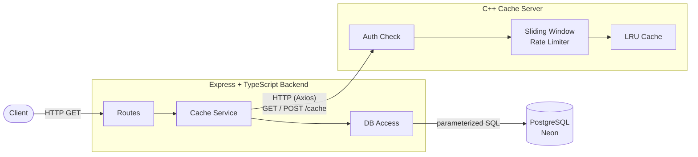

<br>
<br>

### Request Flow

<br>

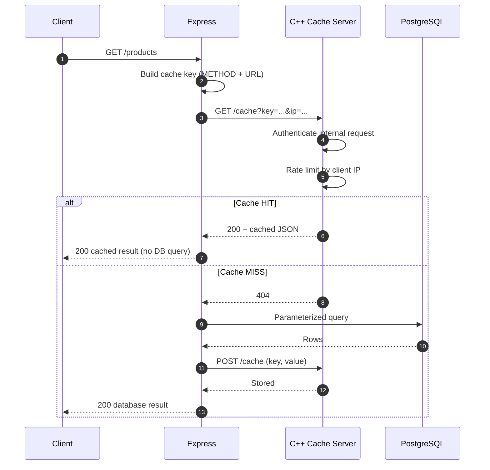

<br>
<br>

### Failure Handling

<br>

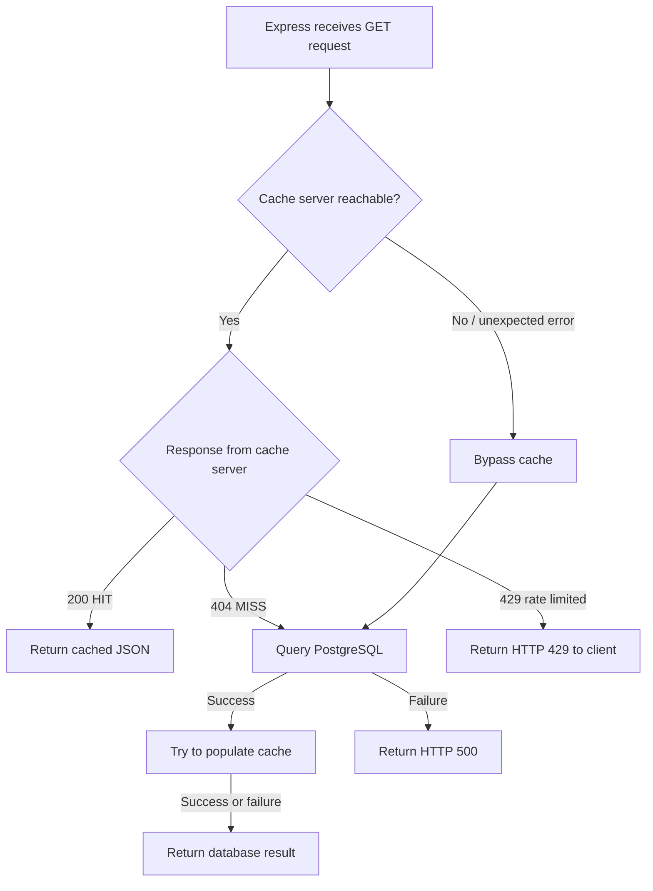

<br>
<br>
<br>

| Scenario | Behaviour |
|---|---|
| Cache HIT | Cached JSON returned; PostgreSQL is not queried |
| Cache MISS (`404`) | Express queries PostgreSQL, populates the cache, returns the result |
| C++ server down or unexpected error | Express bypasses the cache and queries PostgreSQL |
| Cache population fails | The successful database result is still returned |
| Rate limit exceeded | HTTP `429` returned to the client |
| PostgreSQL failure | HTTP `500` returned |

<br>

---

<br>
<br>

## Tech Stack

<br>

| Layer | Technology |
|---|---|
| Cache and rate limiter | C++17, STL (`unordered_map`,  `deque`, `std::chrono`) |
| C++ HTTP server | C++ with a header-only HTTP library in `third_party/httplib.h` |
| Build system | CMake (3.20+) |
| Application backend | TypeScript, Node.js, Express.js |
| Service-to-service HTTP | Axios |
| Database | PostgreSQL on Neon (driver : `pg`) |
| Version control | Git |

<br>

---

<br>
<br>

## Core Features

### LRU In-Memory Cache

Implemented from scratch in C++ (`src/lru-cache/`).

- **Data structures:** an `unordered_map` , plus a `doubly linked list` ordered by recency.
- **Dummy head and tail nodes** remove edge cases when inserting or removing at the ends of the list.
- **Recency:** the most recently used entries sit near the head; the least recently used sit near the tail.
- **Cache hit:** the accessed node is moved to the front.
- **Insertion:** when the cache is at capacity, the entry nearest the tail is evicted before the new one is added.
- **Update:** inserting an existing key updates its value and refreshes its recency.
- **Complexity:** average **O(1)** lookup, insertion and eviction.

<br>

**Why a hash map and a doubly linked list?** A hash map alone gives O(1) lookup but has no notion of order. A linked list alone tracks order but needs O(n) search. Combined, the map finds a node in O(1) and the doubly linked list lets that node be unlinked and moved to the front in O(1) because it already holds pointers to both neighbours.

<br>

### Sliding-Window Rate Limiter

Implemented from scratch in C++ (`src/sliding-window-rate-limiter/`).

- An `unordered_map` tracks each client (keyed by client IP).
- Each client owns a `deque` of request timestamps taken from `std::chrono::steady_clock`, a monotonic clock that is not affected by system clock changes.
- On each request, timestamps older than the window are popped from the front of the deque.
- If the remaining count has reached the limit, the request is rejected; otherwise the new timestamp is recorded and the request is allowed.

<br>

| Setting | Value |
|---|---|
| Default request limit | 10 requests |
| Default window | 60 seconds |
| Keyed by | Client IP |

<br>

**Complexity.** Lookup of the client is average O(1). Each timestamp is pushed once and popped once, so cleanup is **amortized O(1)** per request; a single call that finds many expired timestamps can take O(k) for those k removals. Memory is O(clients × limit) in the worst case.

<br>

### Express Backend Integration

- TypeScript Express app with **routes separated from service logic**.
- A **reusable, centralized cache service** wraps the cache-aside logic so each route does not repeat it.
- Cache keys are built from the **request method and original URL** (for example `GET:/products/category/Electronics`).
- Database access uses **parameterized queries**.
- All communication with the C++ server uses **Axios**.

<br>

How the cache service handles a request:

1. Build the cache key from method and URL.
2. Ask the C++ server for the key (`GET /cache`).
3. **HIT:** return the cached JSON.
4. **MISS (`404`):** run the supplied database query, send the result to the C++ server (`POST /cache`), return the result.
5. **Cache server unavailable or unexpected error:** run the database query and return its result.

<br>

### Failure Handling

The cache is an optimization, not a dependency. If the C++ server is down, times out or returns an unexpected error, Express serves the request from PostgreSQL. If writing to the cache fails, the user still receives the database result. If PostgreSQL itself fails, Express returns an HTTP `500`. If the rate limiter rejects a request, HTTP `429` is returned.

<br>

### Internal API Security

The C++ cache server is an internal service. Only Express is allowed to make requests to C++ `/cache` endpoint. Express authenticates to it with a **shared secret** sent with each request, and the C++ server checks it before doing any work. Secrets are read from environment variables and are never committed to the repository.

<br>

---

<br>
<br>

## API Documentation


### Express API (public)

| Method | Endpoint | Description |
|---|---|---|
| GET | `/` | Express server health check |
| GET | `/db-health` | PostgreSQL connectivity check |
| GET | `/products` | Retrieve all products |
| GET | `/products/:id` | Retrieve a product by ID |
| GET | `/products/category/:category` | Filter products by category |
| GET | `/products/price/:price` | Filter products by maximum price |

<br>

### C++ Cache Server (internal)

These endpoints are called by Express, not by end users.

| Method | Endpoint | Purpose | Request |
|---|---|---|---|
| GET | `/cache` | Look up a cached response | Cache key, client IP address and the internal auth secret |
| POST | `/cache` | Store or update a cached response | JSON body with Cache key and the internal auth secret |

<br>

Status codes used by the cache server :

| Code | Meaning |
|---|---|
| `200` | Cache HIT (GET) or value stored (POST) |
| `404` | Cache MISS |
| `429` | Rate limit exceeded |
| `403` | Missing or invalid internal secret |
| `400` | Invalid request |

<br>

### Example Requests

<br>

**Cache MISS (first request)**

```bash
curl -i http://localhost:3000/products/1
```

```json
{
    "data": [
        {
            "id": 1,
            "name": "Laptop",
            "price": "55000.00",
            "category": "Electronics"
        }
    ],
    "cache": "miss",
    "message": "Cache Populated after DB query"
}
```

The C++ server returned `404`, so Express queried PostgreSQL and populated the cache.

<br>

**Cache HIT (repeat request)**

```bash
curl -i http://localhost:3000/products/1
```
```json
{
    "data": [
        {
            "id": 1,
            "name": "Laptop",
            "price": "55000.00",
            "category": "Electronics"
        }
    ],
    "cache": "hit"
}
```

The data in response body is identical, but it is served from the C++ cache without a database query.

<br>

**Rate limited**

```bash
# Send requests in a loop until the limit is exceeded
for i in $(seq 1 11); do curl -s -o /dev/null -w "%{http_code}\n" http://localhost:3000/products; done
```

Requests beyond the limit return HTTP `429`.

<br>

---

<br>
<br>

## Project Structure


<br>

```
custom-in-memory-cache-and-rate-limiter-from-scratch/
│
├── benchmarks/
│   └── results.md
│
├── build/                                # Generated CMake build files
│
├── express-backend/
│   ├── src/
│   │   ├── routes/
│   │   │   └── products.routes.ts
│   │   ├── services/
│   │   │   ├── products.service.ts
│   │   │   └── cache.service.ts
│   │   ├── db.ts
│   │   └── server.ts
│   ├── package.json
│   ├── package-lock.json
│   └── tsconfig.json
│
├── screenshots/
│   ├── endpoints/
│   ├── caching/
│   ├── rate-limiting/
│   └── failure-handling/
│
├── src/
│   ├── main.cpp
│   ├── lru-cache/
│   │   ├── lru_cache.h
│   │   └── lru_cache.cpp
│   └── sliding-window-rate-limiter/
│       ├── sliding_window_rate_limiter.h
│       └── sliding_window_rate_limiter.cpp
│
├── tests/
│   ├── lru_cache_tests.cpp
│   └── sliding_window_rate_limiter_tests.cpp
│
├── third_party/
│   ├── httplib.h
│   └── dotenv.h
│
├── .gitignore
├── CMakeLists.txt
├── LICENSE
└── README.md
```

---

<br>

## Setup and Installation

### Prerequisites

- A C++17 compiler (GCC, Clang or MSVC)
- CMake 3.20 or newer
- Node.js (18+) and npm (9+)
- A PostgreSQL database; this project uses a free [Neon](https://neon.tech) instance
- Git

### Clone the repository

```bash
git clone https://github.com/rizviammar579/custom-in-memory-cache-and-rate-limiter-from-scratch.git
cd custom-in-memory-cache-and-rate-limiter-from-scratch
```

### Build the C++ server

```bash
cmake -S . -B build -G "MinGW Makefiles"
cmake --build build
```

<br>

This produces three executables (from `CMakeLists.txt`):

| Target | Purpose |
|---|---|
| `cache_rate_limiter` | The HTTP cache and rate-limiter server |
| `lru_cache_tests` | LRU cache tests |
| `sliding_window_rate_limiter_tests` | Rate limiter tests |

<br>

### Install the Express backend

```bash
cd express-backend
npm install
```

<br>

### Configure environment variables

Create the environment files described below. Never commit real values; `.env` is excluded by `.gitignore`.

<br>

**Express backend**: `express-backend/.env`

```env
NEON_DB_URL=your_neon_database_connection_string
CPP_SERVER_SECRET_KEY=your_shared_secret
```

<br>

**C++ server**: `custom-in-memory-cache-and-rate-limiter-from-scratch/.env`

```env
CPP_SERVER_SECRET_KEY=your_shared_secret
```

<br>

### Configure Neon PostgreSQL


1. Create a project and database in the [Neon Console](https://console.neon.tech/).
2. Copy the PostgreSQL connection string provided by Neon.
3. Add your connection string in `express-backend/.env`

   ```env
   NEON_DB_URL=your_neon_connection_string
   ```

4. Open the Neon SQL Editor and execute the following SQL to create the `products` table:

   ```sql
   CREATE TABLE products (
       id SERIAL PRIMARY KEY,
       name VARCHAR(100) NOT NULL,
       price NUMERIC(10, 2) NOT NULL,
       category VARCHAR(50) NOT NULL
   );
   ```

5. Insert sample records into the table:

   ```sql
   INSERT INTO products (name, price, category)
   VALUES
       ('Laptop', 55000.00, 'Electronics'),
       ('Keyboard', 1500.00, 'Accessories'),
       ('Mouse', 800.00, 'Accessories'),
       ('Monitor', 12000.00, 'Electronics'),
       ('Headphones', 2500.00, 'Audio');
   ```

6. Verify the database connection by starting the Express server and accessing:

   ```text
   http://localhost:3000/db-health
   ```

   <br>

**Note:** The sample records are provided for testing. You can insert your own product records using the same schema. Never commit your `.env` file or expose your database connection string.


<br>

### Start the C++ server

```bash
# From the repository root
./build/cache_rate_limiter
```
<br>

### Start the Express server

```bash
cd express-backend
npm run dev        
```

<br>

### Test the API

```bash
curl http://localhost:3000/                 # Express health check
curl http://localhost:3000/db-health        # PostgreSQL connectivity
curl http://localhost:3000/products         # first call: MISS, second call: HIT
curl http://localhost:3000/products/1
curl http://localhost:3000/products/category/Electronics
curl http://localhost:3000/products/price/2500
```

---

<br>


## Screenshots and Demonstrations

### API Endpoints

| All Products | Product by ID |
|:---:|:---:|
| 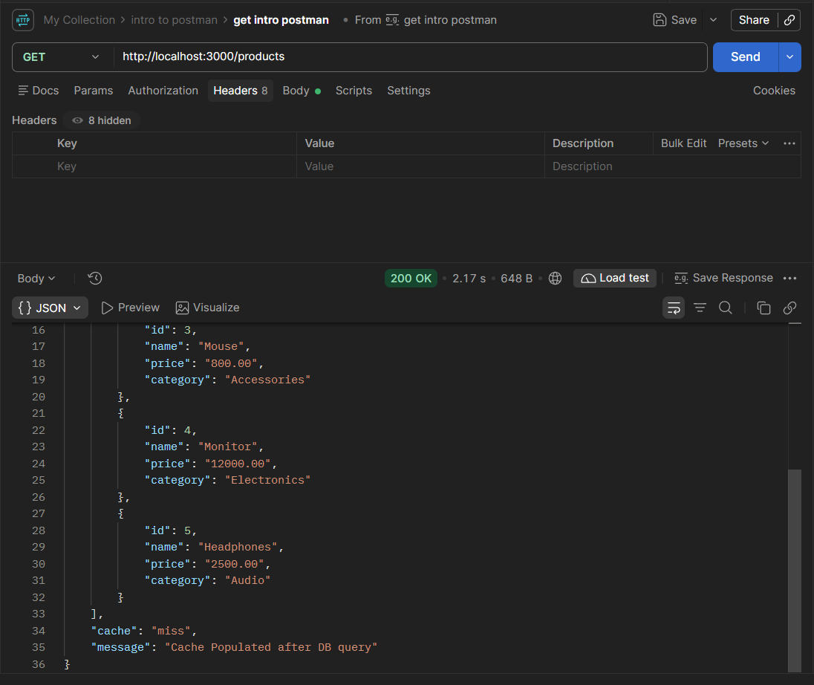 | 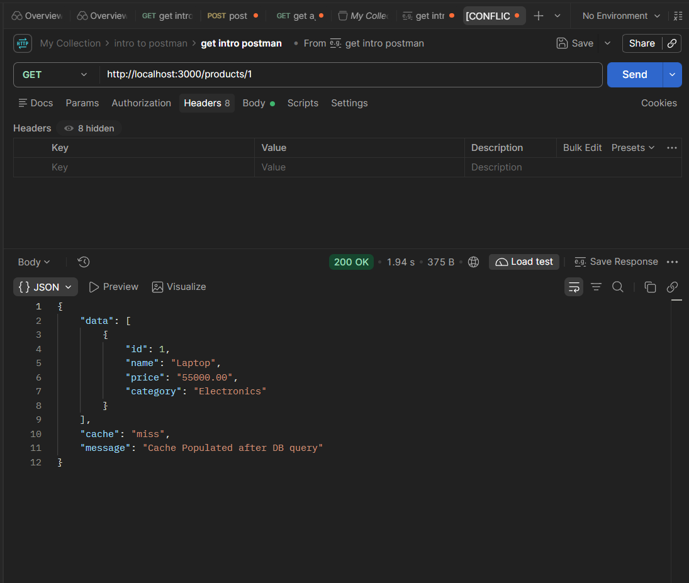 |

| Category Filtering | Price Filtering |
|:---:|:---:|
| 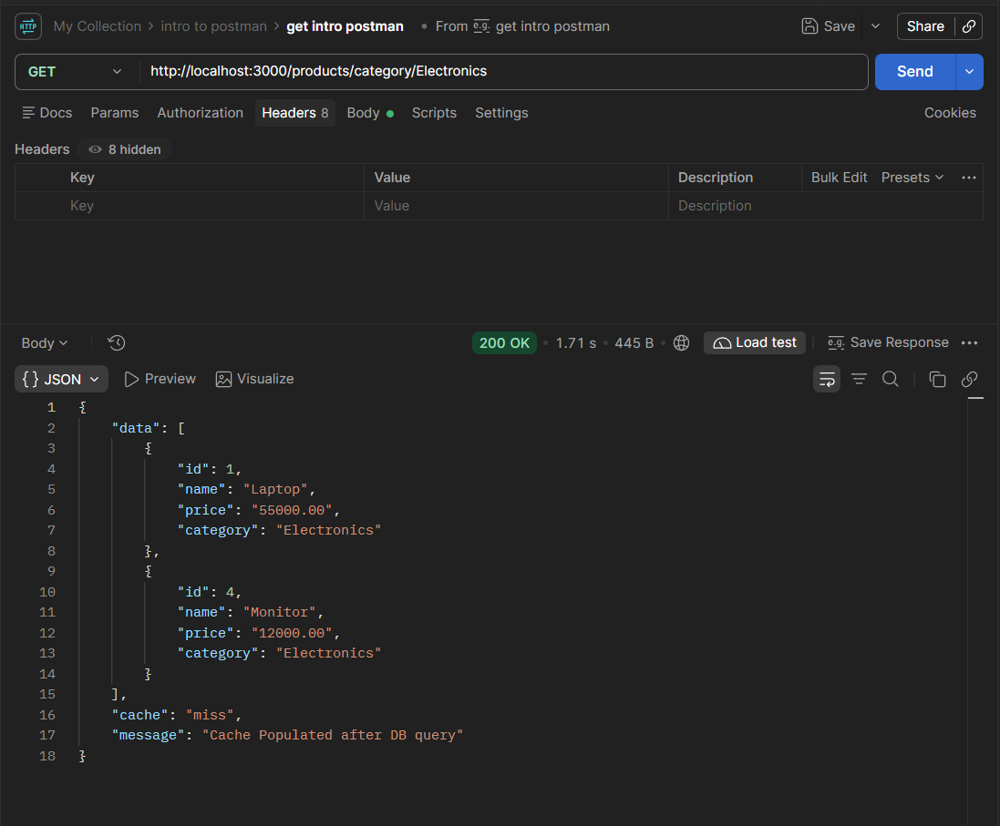 | 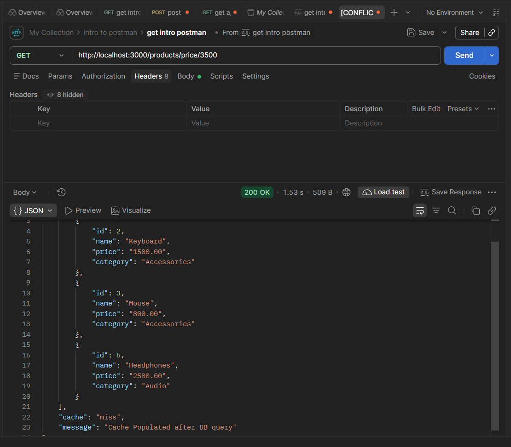 |

### Caching

| Cache MISS | Cache HIT |
|:---:|:---:|
| 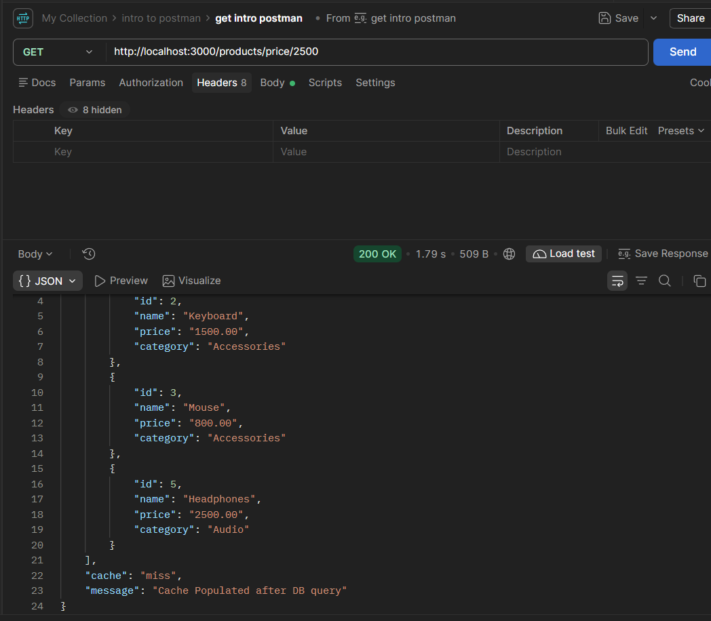 | 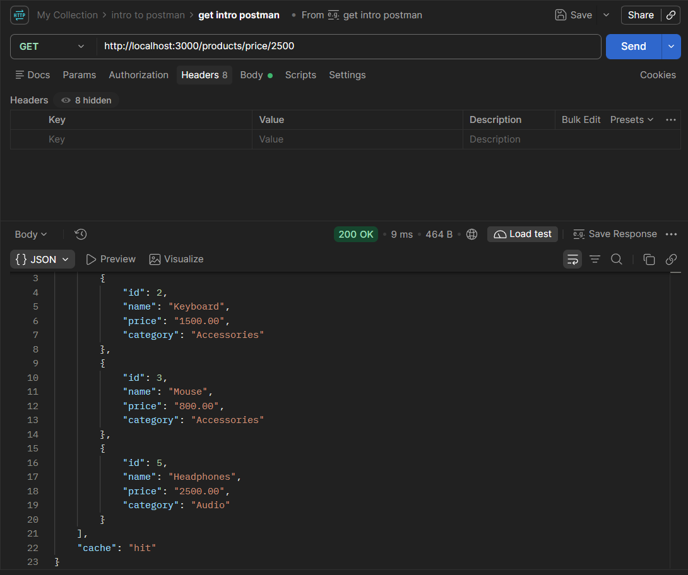 |

### Rate Limiting

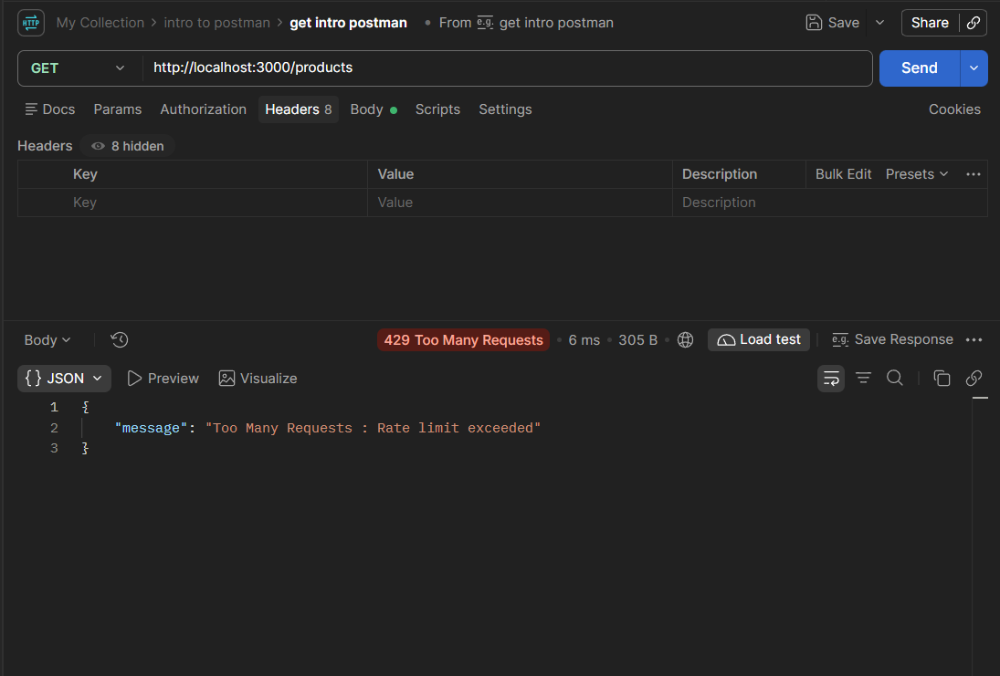

### Failure Handling

| C++ Server Unavailable — PostgreSQL Fallback | 
|:---:|
| 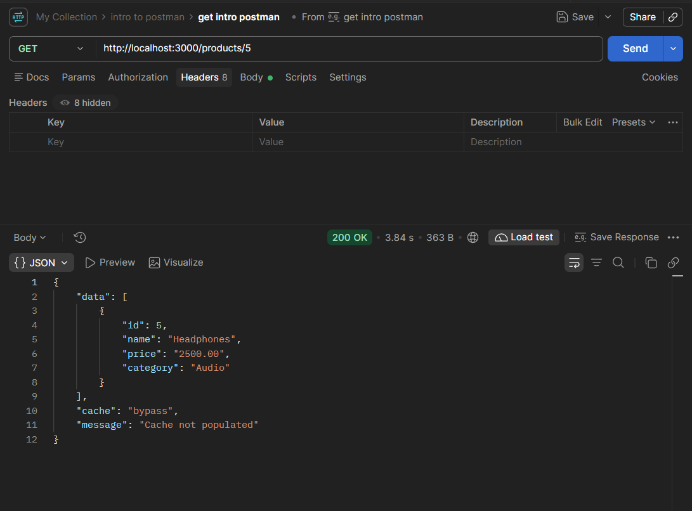 | 


---

<br>
<br>

## Performance Benchmarks


Full results: [`benchmarks/results.md`](benchmarks/results.md)

**What was measured.** End-to-end response time of the same Express endpoint under two conditions, **10 requests each**:

- **Cache MISS:** the key is not in the cache, so Express queries PostgreSQL (hosted on Neon), then populates the cache.
- **Cache HIT:** the key is in the C++ cache, so the response is served without a database query.

<br>

| Metric | Cache MISS | Cache HIT |
|---|---:|---:|
| Average response time | 1598 ms | 10.5 ms |
| Minimum response time | 1070 ms | 4 ms |
| Maximum response time | 2170 ms | 28 ms |

<br>

Average latency dropped by about **99.34%** on cache hits in this test.

> **Note:** these are measurements from a local test environment with a sample size of only 10 requests per scenario. The MISS path includes a network round trip to a remote Neon database, which dominates its latency. The numbers illustrate the effect of caching; they are not a guarantee of production performance.

---

<br>
<br>

## Current MVP Limitations

These are deliberate scope decisions for the MVP, not bugs.

<br>

| Limitation | Why it is acceptable for the MVP |
|---|---|
| LRU eviction only (no LFU) | LRU is simple, predictable and fits read-heavy workloads; other policies are roadmap items |
| No TTL-based expiration | Product data is read-only here, so entries cannot become stale through writes in this app |
| No cache invalidation on data mutation | The Express product API is read-only, so there are no mutations to invalidate |
| Read-only product API | The goal was to demonstrate cache-aside reads and rate limiting |
| In-memory only, no persistence | The cache is rebuilt from PostgreSQL after a restart; losing it costs speed, not data |
| Not a distributed cache | Designed for local execution to focus on core data structures and request flow |
| Rate-limit state is per-process | State lives in the C++ server's memory and is not shared across instances |
| Not validated for large-scale production | Not load-tested at scale; benchmarks are small and local |

<br>

---

<br>
<br>

## Future Roadmap — Version 2 and Beyond

> Nothing in this section is implemented yet.

<br>

### Cache Improvements

- TTL-based cache expiration
- Cache invalidation
- Write operations with appropriate invalidation strategies
- LFU (Least Frequently Used) eviction, including a bucket-based O(1) LFU implementation
- Compare LRU and LFU under different workloads
- Configurable cache policies

### Rate Limiter Improvements

- Token-bucket rate limiting
- Configurable limits per endpoint or client
- Distributed rate limiting

### Scalability and Distributed Systems

- Distributed cache architecture
- Multiple Express backend instances
- Multiple cache server instances
- Cache sharding and consistent hashing
- Load balancing and horizontal scaling
- Synchronization and consistency between instances

### Reliability and Observability

- Structured logging
- Metrics for cache hits, misses, evictions and rate-limit rejections
- Monitoring and health checks
- Integration tests and broader automated test coverage (C++ unit tests for the LRU cache and rate limiter already exist in `tests/`)
- Concurrency and thread-safety improvements
- Graceful shutdown and resource management

<br>

---
<br>
<br>

## Engineering Concepts Demonstrated

<br>

| Concept | Where it appears |
|---|---|
| Data structures and algorithms | Custom LRU cache and sliding-window limiter |
| Hash maps and doubly linked lists | O(1) LRU lookup and recency updates |
| LRU eviction | Capacity-based eviction of the least recently used entry |
| Sliding-window rate limiting | Per-IP timestamp deque with expiry |
| HTTP communication between services | Express to C++ server over Axios |
| REST API design | Read-only product endpoints with path parameters |
| Database integration | PostgreSQL on Neon from Express |
| SQL parameterization | Parameterized queries to prevent SQL injection |
| Cache-aside pattern | Check cache, fall back to DB, populate cache |
| Failure handling and fallback | Cache bypass on error; database result always returned when possible |
| Backend modularization | Separate routes, services and cache service |
| Performance benchmarking | MISS vs HIT latency comparison |
| Unit testing | C++ test executables registered with CTest |

<br>

---

<br>
<br>

## License

Distributed under the MIT License. See [`LICENSE`](LICENSE) for details.
